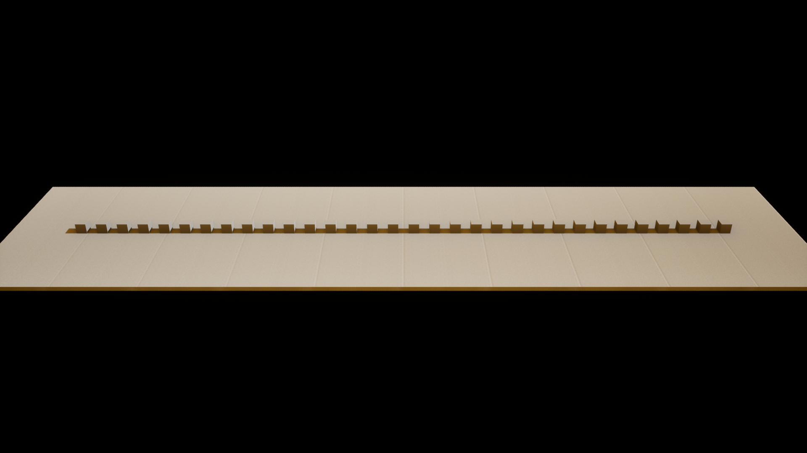

# D08 Static Instanced Line Layout

## Result

Verification date: 2026-09-24 (America/New_York).
Engine: Unreal 5.8.0-55116800+++UE5+Release-5.8.
Source checkpoint: `0039213` on `codex/d08-line-layout`.

**Status: Done.**

D08 implements the centered D03 line layout and a static editor preview using
one `ARTCQTVisualizer` with one `UInstancedStaticMeshComponent`. The saved scene
contains 32 cube instances at local X positions -1550 through +1550, spaced
100 Unreal units apart, with base scale (0.5, 0.5, 0.5). The actor sits at
world Z = 25 so the cubes rest on the ground.

Open `/Game/Maps/L_D08Layout` (`Content/Maps/L_D08Layout.umap`) and select
`D08 - 32 Static Bands`. Expand RTCQT settings in Details to change Expected
Band Count, Layout Settings, Instance Mesh, or Instance Material. Count zero is
an intentional empty preview and reports how to restore a visible row.

The scene uses the engine cube, its default material, a ground mesh, two
lights, and a camera. It has no dependency on the private D07 audio assets.
Audio-driven evaluation remains D09-D12 work; circle and sphere remain D19.

## Implementation

- `RTCQTLayout.cpp` implements line placement and the documented input
  sanitization, preserves index order, and converts the contract axes into
  Unreal transforms. Unsupported modes replace previous output with an empty
  result so the actor can report a clear failure.
- `RTCQTVisualizer.cpp` refreshes on construction/property changes and at
  BeginPlay. Layout/count changes rebuild topology; unchanged inputs preserve
  existing instance transforms and response custom data. A missing component
  instance array or incorrect custom-data width also triggers repair.
- Clearing invalidates the cache. Missing mesh, non-positive counts, and
  unsupported modes clear stale geometry and log once per failure transition.
  Restoring valid settings recovers the row. Missing optional material uses
  the mesh default and warns once on entry.
- The component starts with two custom-data floats: zero response and normalized
  band index. A single instance uses index zero. Tick, collision, and navigation
  contribution are disabled for the visualizer.
- Runtime dependencies remain Core, CoreUObject, Engine, and AudioSynesthesia.
  Python is enabled only for editor verification commands; it is not a runtime
  dependency or a new project plugin requirement.

## Verification

| Check | Evidence |
| --- | --- |
| Development Editor build | `../evidence/d08/build-log.txt` |
| Four Unreal automation groups pass, no unexpected errors/warnings | `../evidence/d08/automation.json`, `automation-log.txt` |
| All seven D03 line cases and eleven expected transforms run against C++ | `RTCQT.D08.Layout.GoldenVectors` |
| 32-band endpoints, deterministic rebuilds, invalid spacing, deferred modes | `RTCQT.D08.Layout.RepeatabilityAndInvalidInputs` |
| Component count, local/world transforms, cache preservation, clear/repair, single band | `RTCQT.D08.Visualizer.TopologyAndCache` |
| Missing mesh/count/material, warning suppression, restoration | `RTCQT.D08.Visualizer.SafeFailuresAndRecovery` |
| Fresh editor process restores 32 instances and exact local transforms | `../evidence/d08/scene-reopened.json`, `scene-reopened-log.txt` |
| Editor property notifications update count/spacing; moving the root moves the whole row | `../evidence/d08/scene-reopened.json` |
| Rebuilding does not spawn actors; removing/restoring mesh and zero count work | `../evidence/d08/scene-reopened.json` |
| Play in Editor retains one visualizer and 32 instances after BeginPlay | `../evidence/d08/play-mode.json`, `capture-log.txt` |
| Rendered editor viewport shows the complete row with visible gaps | `../evidence/d08/line-layout.png` |

The standalone scene verification deliberately exercises missing mesh and zero
count. Its two `LogRTCQT` warnings are expected, followed by successful recovery;
they are not unresolved startup failures. The automated tests assert exact
warning counts, including a fresh warning after recovery and recurrence.

Ownership is recorded by direct editor API inspection in `scene-reopened.json`.
The Windows Computer Use tool could not initialize from this WSL task because
it rejected the task's filesystem URI. A separate Outliner/Details screenshot
was therefore unavailable; the component report preserves that evidence.

The final graphics-enabled capture run completed with no error or ensure entries.
The row was inspected in the resulting 1920 x 1080 image. Asset and evidence
hashes are recorded in `../evidence/d08/verification.json`.



## Reproduction and Recovery

Use the installed Unreal 5.8 editor/toolchain. Commands below are Bash/WSL
commands; the project itself remains on the Windows filesystem.

Build:

```bash
'/mnt/c/Program Files/Epic Games/UE_5.8/Engine/Binaries/DotNET/UnrealBuildTool/UnrealBuildTool.exe' \
  RTCQTEditor Win64 Development \
  '-Project=C:\Users\camch\source\RTCQT\RTCQT.uproject' -WaitMutex -NoHotReloadFromIDE
```

Run the C++ automation suite:

```bash
'/mnt/c/Program Files/Epic Games/UE_5.8/Engine/Binaries/Win64/UnrealEditor-Cmd.exe' \
  'C:\Users\camch\source\RTCQT\RTCQT.uproject' \
  -unattended -nop4 -nosplash -NullRHI -NoSound \
  '-ExecCmds=Automation RunTests RTCQT.D08' '-TestExit=Automation Test Queue Empty' \
  '-ReportExportPath=C:\Users\camch\source\RTCQT\Saved\Automation\D08'
```

Verify the saved scene in a fresh process:

```bash
'/mnt/c/Program Files/Epic Games/UE_5.8/Engine/Binaries/Win64/UnrealEditor-Cmd.exe' \
  'C:\Users\camch\source\RTCQT\RTCQT.uproject' \
  -unattended -nop4 -nosplash -NullRHI -NoSound -EnablePlugins=PythonScriptPlugin \
  -run=pythonscript \
  '-script=C:/Users/camch/source/RTCQT/planning/scripts/setup_d08_layout.py --verify'
```

If the level is absent, change `--verify` to `--create` to reconstruct it from
engine assets. Creation refuses to overwrite an existing level. Verification
temporarily changes its settings, restores the documented values, and saves.
Use a separate editor process rather than running it over an unsaved workspace.

`planning/scripts/capture_d08_layout.py` runs in the full editor with
`-EnablePlugins=PythonScriptPlugin` and `-ExecutePythonScript=<absolute path>`.
It verifies Play in Editor, captures the saved scene through Unreal's screenshot
API, and closes its editor process. Reports and captures go under
`Saved/Automation/D08`; reviewed evidence is copied into `planning/evidence/d08`.

Git LFS 3.7.1 is installed with Windows Git and configured locally for this
repository. `.gitattributes` tracks authored `.umap` and `.uasset` files through
LFS; private audio remains ignored. Use Windows Git for this checkout when
working from WSL, or install Git LFS in WSL before using Linux Git on LFS assets.
The level object is stored locally with the checkpoint; publishing it requires
pushing the branch and its LFS object together. The scene creation script is
also a text-only recovery path.
