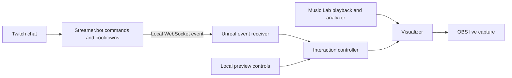

# Viewer chat interactions: palette, shape, and pulse

Draft plan, 2026-10-13 (America/New_York). Target: the live Music Lab in
`C:\Users\camch\source\RTCQT\RTCQT.uproject`.

Streamer.bot is now set up on the workstation. Use it for Twitch login,
command triggers, and chat cooldowns. Connect Unreal directly to its local
WebSocket server. The first connection test is described in
`streamerbot_first_command.md`; the visual-effect and rehearsal gates below
remain pending.

## Viewer experience

Viewers can choose the visualizer's appearance and add occasional accents
while the selected music continues playing.

| Command | Proposed behavior | Initial global / per-user cooldown |
| --- | --- | --- |
| `!palette` | Cycle Neon, Sunset, Ice, and Ember; blend colors over 0.5 seconds. | 15 / 30 seconds |
| `!palette ice` | Select a named palette from the same list. | 15 / 30 seconds |
| `!shape` | Cycle Line, Ring, and Sphere once each has passed visual verification. | 30 / 60 seconds |
| `!shape ring` | Select a named arrangement from the same list. | 30 / 60 seconds |
| `!pulse` | Add one gentle size/glow accent, then settle back over about 1.2 seconds. | 5 / 15 seconds |

Use case-insensitive commands and exact command-token matching. Reject unknown
names and extra arguments with a short usage hint. Bare commands cycle in a
fixed order, making testing and viewer expectations predictable. Cooldowns
are starting values to tune during rehearsal.

Palette and shape remain selected until changed or reset, including across
track switches. Reset returns to the authored default palette and line.
Restarting the app starts at those defaults. Pulse is temporary, applies
only during active playback, and does not stack or queue. Pause, stop,
restart, track switch, reset, or chat disconnection cancels an active pulse.

Show brief accepted-command feedback such as "Ice palette" or "Pulse!" in
the visualizer. Keep connection details and error logs in the streamer panel.

## What the current project provides

- `RTCQTMusicLabManager` owns track selection, playback, pause, and restart.
  Its audio-mixer callbacks provide the song position used for analysis.
- `RTCQTMusicLabControls` provides the dropdown and playback controls. Add
  local interaction previews and a viewer-controls toggle here.
- `RTCQTVisualizer` uses one instanced-mesh component and a shared dynamic
  material. Runtime setters are needed for interaction state.
- The D12 material setup already exposes `LowBandColor` and `HighBandColor`
  vector parameters. Reuse them for two-color palette presets.
- `RTCQTTypes` declares Line, Circle, and FibonacciSphere, but
  `RTCQTLayout::Build` and `RTCQTVisualizer::RebuildInstances` currently
  support only Line. Ring and sphere require implementation and camera work.
- Existing planning identifies additional layouts as D19 work. Coordinate
  that scope with this plan; the chat prototype does not complete D19 itself.

The interactive stream needs OBS to capture a running Unreal scene and its
audio. The original rendered-video delivery path cannot respond to these
commands. Live capture can use the existing preanalyzed music library;
external live-audio analysis is not a prerequisite for this feature.

## Connection and ownership



Add an interaction component to the Music Lab manager with typed entry points
for selecting/cycling palettes, selecting/cycling layouts, triggering a pulse,
resetting, and enabling viewer controls. The local controls and chat receiver
call those same entry points. Keep its session state separate from the saved
response assets.

Use Streamer.bot's WebSocket server on `127.0.0.1`. Commands run short actions
that broadcast a namespaced RTCQT JSON event. The Unreal client subscribes to
the appropriate custom-event stream, unwraps the Streamer.bot envelope, then
validates the RTCQT payload. Verify the installed version's actual broadcast
envelope with one captured event before fixing the parser.

Proposed application payload inside that envelope:

```json
{
  "schema_version": 1,
  "topic": "rtcqt.visuals",
  "request_id": "unique-command-id",
  "command": "palette",
  "value": "ice",
  "user_id": "twitch-user-id",
  "issued_at": "2026-10-13T18:00:00Z"
}
```

Allow only the documented commands and preset names. Validate before changing
the current visual state. Deduplicate request IDs, discard expired events,
bound the receive queue, and dispatch visual changes on Unreal's game thread.
Do not replay commands received while disconnected. Keep the last palette
and shape through reconnect, resubscribe, and start with a neutral pulse.

Streamer.bot handles viewer permissions and per-user cooldowns. Unreal also
enforces global effect limits, pulse duration, and the streamer lock. This
matters because Streamer.bot exempts the broadcaster from its cooldowns.
Configure local WebSocket authentication using an ignored workstation setting;
Twitch credentials stay in Streamer.bot.

## Visual implementation rules

**Palette:** store named low/high color pairs in a preset DataAsset. Interpolate
from the currently displayed pair to the target pair, so even a local override
mid-transition remains smooth. Apply the pair to the shared dynamic material;
routine material refreshes must preserve the runtime selection.

**Shape:** implement Circle and FibonacciSphere using the existing layout
contract and expose them as `ring` and `sphere`. Each has an authored spacing
or radius and camera framing that fits the active band count. Start with a
clean switch; animated morphing can follow later. After rebuilding, immediately
apply the current analyzed frame. Preserve band ordering and the song position.
An invalid layout request leaves the last valid display intact.

**Pulse:** keep the analyzed music response as the base frame and compose a
bounded temporary accent over it. Start with a quick rise and smooth decay,
about 15% extra size and 25% extra glow, then tune by eye. At the end, the
accent is exactly neutral relative to the music's current frame. Never
multiply an already accented frame or restore a snapshot of older music.

Use a monotonic elapsed-time envelope for live transitions, with display
updates while an effect is active. That clock controls the visual accent;
audio-mixer callbacks continue to supply the analyzer's song position.
Give the live interaction layer an explicit enable flag and neutral defaults
so ordinary offline evaluations retain their existing behavior.

## Delivery cards, in dependency order

| Card | Observable outcome | Acceptance gate |
| --- | --- | --- |
| I01: Music Lab and capture baseline | The dropdown scene works as the live source. | Listen to switching, pause/resume, and restart; confirm one audible track and recognizable visual alignment. Record a short OBS capture with one audio route. |
| I02: Local controller and palettes | Local controls choose four smooth color presets. | Repeated changes preserve playback; selected colors survive normal evaluation and track switches; reset works. |
| I03: Local pulse | One button produces a bounded accent and settles back. | At several music positions, verify duration, return to the current baseline, no stacking, and cancellation on playback changes. |
| I04: Layouts and camera | Line, ring, and sphere are usable visual arrangements. | Verify ordered bands, finite transforms, correct counts, camera framing, and switching during playback with 16/32/64 bands. |
| I05: Streamer.bot integration | Actual Twitch commands call the same controller. | Verify command parsing, named/bare forms, cooldowns from a viewer account, duplicate/malformed messages, streamer lock, and disconnect/reconnect. |
| I06: Stream rehearsal and recovery | All three interactions work in the captured broadcast. | Pass a 15-minute OBS rehearsal, restart both apps, confirm controls and presets load, and record human audiovisual feedback. |

I02 and I03 can form an early two-command release while I04 is still pending.
I05 depends on the local effects included in that release. Expose shape names
to viewers only after I04 passes. Finish the Music Lab listening gate before
calling its baseline complete.

### Streamer.bot setup within I05

1. Connect the Twitch broadcaster account and verify incoming chat.
2. Create a simple test action that logs a command invocation. Prove it from
   real Twitch chat before introducing Unreal.
3. Enable the local WebSocket server; choose an available port, configure
   authentication, and save the endpoint in the Unreal workstation settings.
4. Create separate palette, shape, and pulse commands with the proposed
   cooldowns. Use Twitch chat as the command source and ignore bot messages.
5. Attach actions that parse allowed arguments and broadcast RTCQT events.
   Export the commands/actions for recovery.
6. Connect Unreal, authenticate, subscribe, and confirm one captured event
   reaches the local controller. Check each command from a viewer account;
   the broadcaster account cannot prove Streamer.bot cooldown behavior.

### Verification and release evidence

Add focused automation for runtime state, pulse composition, layout generation,
and receiver rejection/reconnect behavior. Run the existing RTCQT automation
suite after runtime changes. A parser test alone does not prove Twitch delivery,
and automated frame checks do not replace listening and visual review.

During rehearsal, try normal commands, invalid names, bursts, palette/shape
changes during a pulse, track changes, pause/restart, chat lock, and restarting
Streamer.bot while music plays. Measure accepted local event-to-display delay
and OBS rendering/encoding performance against I01. Viewers will also see the
broadcast's delivery delay.

Retain exported Streamer.bot actions without credentials, setup instructions,
logs, screenshots, and a short OBS recording under
`planning/evidence/viewer-interactions/`. Provide a local viewer-controls
toggle and reset button, plus an OBS fallback scene. First-release acceptance
requires the user's confirmation that music, accent decay, and all camera
arrangements look and sound right after restarting.

## Later enhancements

Beat-quantized accents, layout morphing, voting, channel-point rewards, and
extra visual presets can follow the three-command rehearsal. The initial
pulse responds immediately; it does not promise beat detection.

## External references checked for this plan

- [Streamer.bot commands](https://docs.streamer.bot/guide/core/commands):
  command matching, sources, permissions, and cooldowns.
- [WebSocket configuration](https://docs.streamer.bot/api/websocket/guide/configuration):
  local binding, port, endpoint, and authentication.
- [Receiving WebSocket events](https://docs.streamer.bot/api/websocket/guide/events):
  subscriptions and the event envelope.
- [General.Custom event](https://docs.streamer.bot/api/websocket/events/general/custom):
  custom-event payload reference; confirm actual broadcasts on the workstation.
- [WebSocket C# methods](https://docs.streamer.bot/api/csharp/methods/core/websocket):
  JSON broadcasting from actions.
