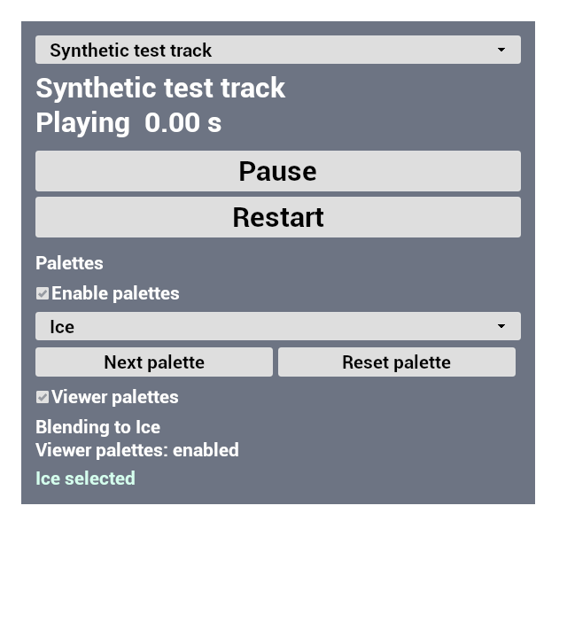
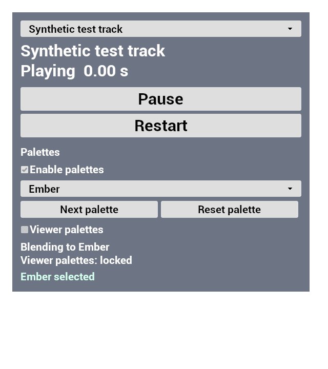

# Palette step 3: native controls and repeatable presets

Validated 2026-10-15 (America/New_York), UE 5.8.0-55116800, authoritative
checkout `C:\Users\camch\source\RTCQT`. Native implementation and automated
checks passed. Cam's saved level assignment and human scene/playback checks
remain pending; follow [the setup handoff](../../documents/streamerbot_palette_controls.md).

## Delivered behavior

The native Music Lab widget retains track selection, Play/Pause, and Restart
and adds a palette dropdown, feature checkbox, Next/Reset, a **Viewer
palettes** checkbox, status, and two-second acceptance/error feedback. The
viewer checkbox affects palettes only. Local selection remains available
through the viewer lock and cooldown.

The dropdown uses validated preset display names mapped to stable IDs;
duplicate labels get suffixes. **Authored colors** selects reset. UI
synchronization and direct/programmatic selections do not issue requests.
External local/viewer changes synchronize selection and status. A fresh
transient widget tree supports Slate rebuilds without stale named widgets.

The panel has a background for readable overlay text. The rendered native
test widget was inspected in disabled, selected, and viewer-locked states;
labels and controls fit the captured area. These screenshots use a synthetic
track and establish widget rendering, not a live Music Lab scene result.

`setup_palette_presets.py` creates only
`/Game/Audio/PrivateTest/MusicLab/DA_MusicLabPalettes`, tagged
`RTCQT.Owner=RTCQT.PalettePresets.v1`. Reuse validates without saving;
`-RTCQTPaletteResetDefaults` explicitly restores all four starter presets.
Wrong-class or unowned collisions are refused. The script does not load or
save the Music Lab level or run the broader Music Lab setup.

## Passing validation

- `RTCQTEditor Win64 Development` native build, including header generation.
- Full `RTCQT.` automation: **35 tests, 34 clean successes, one success with
  the existing `RTCQT.MusicLab.Switching` optional material fallback warning,
  zero failures, zero unrun, zero in process**. All seven palette tests passed
  without warnings, as did the existing Streamer.bot protocol test.
- New `RTCQT.Palette.Controls`: opt-in/disabled state, stable IDs and duplicate
  labels, direct-selection suppression, local Next/Reset through viewer lock,
  external selection synchronization, viewer acceptance feedback and expiry,
  widget rebuild, rejected invalid setup, and missing manager safety. The
  existing AudioComponent, playback state, and analysis callback count remain
  unchanged through palette operations.
- A second run of only `RTCQT.Palette.Controls` with
  `-RenderOffscreen -RTCQTPaletteCaptureUI` and rendering enabled: **one clean
  success**, zero failures or unrun tests. Three 640x720 native widget PNGs
  were captured and visually inspected.
- The exact setup script commandlet entry point created the real preset
  asset successfully. `verify_palette_presets.py` then confirmed byte-for-byte
  reuse, preservation of saved artist colors and labels on an isolated owned
  asset, explicit default reset, refusal of an unowned asset, and unchanged
  production preset hash. Its unique temporary asset was removed successfully.
- Both Python scripts passed syntax checks; source/document whitespace
  checks passed.

The exported reports were inspected directly rather than relying on Unreal's
process exit code. A compact record, including all protected-file hashes, is
[palette-step3-validation.json](palette-step3-validation.json).

Workstation outputs (ignored by Git):

| Output | Location |
| --- | --- |
| Build log | `Saved/Logs/Palette-step3-build.log` |
| Full automation | `Saved/Automation/PaletteStep3/Tests/index.json` |
| Full test log | `Saved/Logs/Palette-step3-tests.log` |
| Rendered test report | `Saved/Automation/PaletteStep3/UI/index.json` |
| Rendered test log | `Saved/Logs/Palette-step3-ui.log` |
| Native widget PNGs | `Saved/Automation/PaletteStep3/captures/` |
| Preset reports | `Saved/Automation/PaletteStep3/setup.json`, `setup-rerun.json`, `setup-final.json`, `preset-verification.json` |
| Preset logs | `Saved/Logs/Palette-step3-setup.log`, `Palette-step3-presets.log` |
| Preservation snapshots | `Saved/Automation/PaletteStep3-protected-before.json`, `PaletteStep3-protected-after.json` |

The full suite used `/Engine/Maps/Entry -NullRHI -NoSound`,
`-ExecCmds="Automation RunTests RTCQT."`, and
`-TestExit="Automation Test Queue Empty"`. The rendered run used the same
entry map and test-exit gate, selected only `RTCQT.Palette.Controls`, omitted
`-NullRHI`, and added the two rendering/capture flags above. The setup handoff
contains the tested PythonScript commandlet invocation in WSL/Bash form.

## Concurrent-work preservation and remaining gates

Unreal was closed before the native build and commandlet sessions. SHA-256
checks matched before and after validation for all seven protected files:
Cam's saved pulse Blueprint, Music Lab level, manager Blueprint, controls
Blueprint, receiver implementation/header, and receiver protocol test.
The saved preset is the only new production Unreal asset. The private
DataAsset is ignored by Git and reproducible from the committed script.

No pulse graph, keyboard binding, receiver allowlist, Streamer.bot action,
credential, or shared-level setting was edited. Cam's dirty pulse Blueprint
remains local and excluded from this delivery.

Native fixtures do not establish actual keyboard interaction, audible music,
perceptual blend quality, live combined pulse/palette behavior, or saved
level setup after an editor restart. Those remain explicit human checks in
the handoff. Palette receiver allowlisting remains step 4, and real Twitch
palette delivery awaits its later bot action and end-to-end check.
